# Agentic Verification Engine (AVE)

A production-grade reference architecture demonstrating the evolution from **fragile deterministic state graphs** to **dynamic LLM tool-calling agents** and **multi-agent assurance swarms**.

---

## 1. Quickstart & CLI Execution Examples

All scripts feature a modular CLI interface accepting dynamic input parameters (`--order-id`, `--query`, `--customer-id`, `--model`, `--json`). No inputs are hardcoded.

```bash
# Set your workspace directory:
cd /Users/iraoliverfernando/Desktop/Dioscuri

# Set Python runner alias:
PYTHON="ai-agent-lab/.venv/bin/python"
```

### Stage 1: Deterministic Keyword Tree (The Baseline)
Evaluates requests against a static string-matching decision tree.

```bash
$PYTHON ai-agent-lab/agentic-verification-engine/scripts/stage1_deterministic_tree.py \
  --query "The sole detached from my boots after two days." \
  --delivery-date "2026-10-20" \
  --sale-item
```
*Expected Behavior: Fails to detect defect because 'detached' is missing from the hardcoded keyword list.*

---

### Stage 2: Single-Agent Dynamic Reasoner (OpenRouter Live Calling)
Uses an OpenRouter-backed model (e.g. `openai/gpt-4o-mini`, `anthropic/claude-3.5-sonnet`) to extract intent and run read-only policy simulation tools.

```bash
# Example 1: Clear defect on clearance shoes
$PYTHON ai-agent-lab/agentic-verification-engine/scripts/stage2_single_agent_reasoner.py \
  --order-id "ORD-1001" \
  --customer-id "CUST-882" \
  --query "The stitching completely unraveled around the cuff." \
  --model "openai/gpt-4o-mini"

# Example 2: Normal return request
$PYTHON ai-agent-lab/agentic-verification-engine/scripts/stage2_single_agent_reasoner.py \
  --order-id "ORD-1001" \
  --query "The jacket does not fit me well. Can I exchange for a larger size?"

# Example 3: Clean JSON output for automated test harnesses & evals
$PYTHON ai-agent-lab/agentic-verification-engine/scripts/stage2_single_agent_reasoner.py \
  --order-id "ORD-1001" \
  --query "Item is broken." \
  --json
```

---

### Stage 3: Multi-Agent Distributed Swarm
Executes a multi-agent pipeline (`Intake Agent` -> `Policy Auditor` -> `Assurance Officer`) and emits audit telemetry (token usage, handoffs, latency).

```bash
$PYTHON ai-agent-lab/agentic-verification-engine/scripts/stage3_multi_agent_system.py \
  --order-id "ORD-1001" \
  --customer-id "CUST-882" \
  --query "The sole detached from my boots after two days of light walking." \
  --model "openai/gpt-4o-mini"
```

---

## 2. CLI Argument Reference

| Flag | Long Flag | Description | Default |
| :--- | :--- | :--- | :--- |
| `-o` | `--order-id` | Target order ID to look up in the database | *Required* |
| `-q` | `--query` | Raw customer message, claim, or email text | *Required* |
| `-c` | `--customer-id` | Optional customer identifier for ticket linking | `None` / `GUEST` |
| `-m` | `--model` | Model name routed through OpenRouter | `openai/gpt-4o-mini` |
| | `--json` | Emits machine-readable JSON for eval suites | `False` |

---

## 3. Architecture Overview

```mermaid
flowchart TD
    subgraph Stage1["Stage 1: Keyword Tree"]
        S1_In["Customer Input"] --> S1_Scan["String Matching ('defective', 'broken')"]
        S1_Scan --> S1_Decision{"Keyword Found?"}
        S1_Decision -->|Yes| S1_OK["Fixed Return Action"]
        S1_Decision -->|No / Novel Text| S1_Fail["Escalate / Reject"]
    end

    subgraph Stage2["Stage 2: Single-Agent Reasoner"]
        S2_In["Customer Input"] --> S2_Auth["Deterministic Auth Gate"]
        S2_Auth --> S2_LLM["LLM Reasoner (OpenRouter)"]
        S2_LLM -->|Tool Call| S2_Sim["Policy Simulation (Read-Only)"]
        S2_Sim -->|Structured Result| S2_LLM
        S2_LLM --> S2_Verdict["Verdict + Human Escalation Docket"]
    end

    subgraph Stage3["Stage 3: Multi-Agent Swarm"]
        S3_In["Customer Input"] --> Agent_Intake["1. Intake Agent (Entity & Claim Extraction)"]
        Agent_Intake --> Agent_Audit["2. Policy Auditor Agent (Rule & Data Verification)"]
        Agent_Audit --> Agent_Assurance["3. Assurance Officer Agent (Risk & Approval Docket)"]
        Agent_Assurance --> S3_Verdict["Consensus Verdict & Telemetry"]
    end
```



---

## 4. Key Architectural Principles

1. **Read-Only Simulation & Decision Drafting (Zero Financial Risk)**:
   - In early iterations, agents draft verification decisions rather than executing money disbursements directly.
   - Pydantic-typed verdicts include confidence scores and policy citations.
   - Human reviewers receive a 1-click execution docket.
2. **Provider-Agnostic LLM Routing via OpenRouter**:
   - Easily swap between Claude 3.5 Sonnet, Gemini 2.5 Flash, or Llama 3.3 without changing business logic.
3. **Atomic Cloud Sync Pattern (Local Draft -> Cloud Commit)**:
   - Draft, test, and iterate on artifacts locally in Markdown for $0 token overhead.
   - Perform atomic synchronization directly to Google Drive when artifacts are ready.

---

## 5. Documentation & Published Artifacts

- **Portfolio Case Study**: [docs/blog-post-from-graphs-to-agents.md](docs/blog-post-from-graphs-to-agents.md)
- **Architecture Specification**: [agentic-verification-engine-plan.md](https://drive.google.com/file/d/1BaqXcO-rhtFEtk_ls7-PUKlE4Bz6uGq8/view?usp=drivesdk)
- **Google Drive Publication Sync**: [Dioscuri / AI Agents](https://drive.google.com/drive/folders/1tQWPy_sYu1_VpNayorQW10vuPFvGeWFf)
