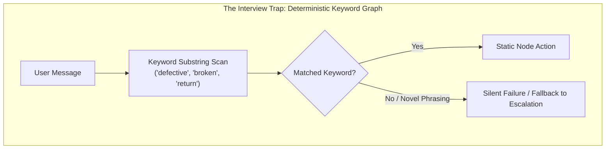
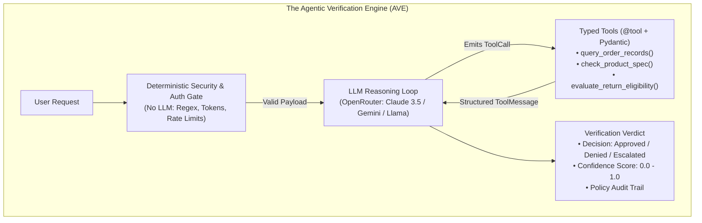

# From Fragile If-Else Graphs to True Agentic Reasoning: Designing an Agentic Verification Engine

*By a Senior Data Scientist transitioning into Agentic AI Engineering*

---

## 1. The Interview Trap: When a Graph Isn't an Agent

During a recent high-stakes AI engineering technical interview, I was tasked with building an automated verification and customer support workflow under an aggressive time box. 

Racing against the clock, the implementation landed on what looked like a sophisticated architecture on paper: a compiled **LangGraph `StateGraph`** with modular nodes for intent classification, order lookup, and policy routing.



Under the hood, however, there was a glaring flaw:
```python
# The brittle reality under time pressure:
defect_words = ["defective", "broken", "damaged", "faulty"]
is_defective = any(w in text.lower() for w in defect_words)

injection_triggers = ["ignore previous instructions", "system prompt", ...]
```

Despite being wrapped in a state graph, **zero actual AI was taking place**. There was no model invocation, no dynamic schema-based tool calling, and no contextual reasoning. The moment a user expressed a return request with novel phrasing—*"The seam unraveled on my first wash"*—the keyword parser failed, dumping the case into a generic human escalation queue.

As an engineer with a senior data science background, this was frustrating. Hardcoded rule books (similar to legacy RPA) are valid for tiny, fixed domains, but they completely collapse under real-world conversational variance. True AI engineering isn't just drawing graph edges; it is **giving an autonomous agent the bounded ability to reason, call tools, and verify policy compliance**.

---

## 2. The Solution: The Hybrid Gatekeeper Architecture

To turn this learning experience into an open-source portfolio asset, I redesigned the system from the ground up: the **Agentic Verification Engine (AVE)**.

The core insight is the **Hybrid Gatekeeper Pattern**:
1. **Deterministic Guardrails First**: Never waste LLM tokens or introduce hallucination risk on things code does best (identity authentication, rate-limiting, schema validation, and SQL/API safety).
2. **Dynamic LLM Tool-Calling in the Middle**: The model reasons over unstructured context, selects typed tools, and observes execution outputs.
3. **Structured Verification Verdict**: The agent produces a typed verdict with a confidence score and audit trail.
4. **Human Handoff as an Exception, Not a Crutch**: The agent escalates to humans only when data is genuinely missing or policy ambiguity exceeds safety thresholds.



---

### The Million-Dollar Question: "Did the Agent Process the Refund?"

During the interview review, the panel asked a critical question:
> *"Does your agent process the refund directly?"*

My answer was decisive: **In iteration one, absolutely not.**

Premature autonomy is one of the costliest mistakes teams make when moving from demos to production. If an uncalibrated agent hallucinates a policy exception and executes a refund or cancels an active contract, that is an immediate, irreversible financial loss. 

Instead, the maturation path must follow three disciplined phases:
1. **Phase 1: Shadow Simulation & Draft Recommendations (Zero Risk)**: The agent runs in read-only mode. It inspects orders, evaluates policy clauses, and drafts a structured recommendation (`approve`, `deny`, or `escalate`), but a human retains execution authority.
2. **Phase 2: One-Click Human-in-the-Loop Approval**: Once agent precision is quantified on hundreds of synthetic and historical cases, the human’s role shifts from manual investigator to single-click approver of the agent’s pre-filled docket.
3. **Phase 3: Tiered Autonomous Execution**: Low-risk actions (e.g. exchanges or refunds under $25) are automated; high-value or edge-case claims remain gated by human review.

This principle underpins our tool design: our tools are **read-only simulation engines**, not reckless state mutators.

---

## 3. Core Implementation Highlights

### A. Provider-Agnostic LLM Routing via OpenRouter
Rather than locking into a single proprietary SDK, the engine utilizes OpenRouter as an abstraction layer. This allows switching between Claude 3.5 Sonnet, Gemini 2.5 Flash, or open-source Llama 3.3 models with zero code changes:

```python
# src/verification_engine/config.py
from langchain_openai import ChatOpenAI

def get_model(provider: str = "openrouter", model_name: str = "anthropic/claude-3.5-sonnet") -> ChatOpenAI:
    return ChatOpenAI(
        model=model_name,
        openai_api_key=os.getenv("OPENROUTER_API_KEY"),
        openai_api_base="https://openrouter.ai/api/v1",
        temperature=0.0,
        default_headers={"X-Title": "Agentic Verification Engine"}
    )
```

### B. Typed Schemas & Audit-Proof Verdicts
In verification domains (e.g. e-commerce compliance, financial auditing, or digital MRV in climate tech), an agent must never emit vague conversational responses. Every verdict is strictly typed:

```python
# src/verification_engine/schemas.py
from pydantic import BaseModel, Field
from typing import Literal

class VerificationVerdict(BaseModel):
    is_eligible: bool
    confidence_score: float = Field(ge=0.0, le=1.0)
    decision: Literal["approved", "denied", "escalated_to_human"]
    reasoning: str
    applicable_policy_rule: str
    recommended_action: Literal["none", "refund", "exchange", "human_review"] = "none"
    case_ticket_id: str | None = None
```

### C. Moving from Hardcoded Strings to Dynamic Tools
Instead of scanning for `"defective"`, tools are exposed with rich docstrings that the model autonomously reasons about:

```python
@tool
def evaluate_policy_eligibility(order_date: str, delivery_date: str, is_defective: bool, is_sale_item: bool) -> dict:
    """Evaluate return and exchange eligibility against published warranty guidelines.
    
    Returns structured eligibility status, maximum refundable amount, and required human review triggers.
    """
    # Deterministic policy logic executed safely inside the tool
    ...
```

---

## 4. The Data Scientist's Advantage in AI Engineering

Transitioning from Senior Data Science to AI Engineering initially gave me impostor syndrome. But this refactoring journey revealed that data scientists possess critical advantages:

1. **Statistical Rigor vs. Prompt Guessing**: Prompt engineers often test on 2 or 3 manual prompts. Data scientists build synthetic evaluation suites, compute precision/recall on tool invocation, and calculate confidence intervals.
2. **Domain Understanding (dMRV & Assurance)**: In emerging fields like **Digital Monitoring, Reporting, and Verification (dMRV)** for carbon markets (such as TÜV SÜD's climate assurance initiatives), verification isn't just a chatbot—it's a verifiable audit pipeline combining geospatial data, anomaly detection, and LLM policy parsing.
3. **Boundary Discipline**: Knowing when **not** to use an LLM (auth, deterministic calculations) is just as important as knowing how to prompt one.

---

## 5. What's Next: The Multi-Model Evaluation Experiment

With the clean architecture established, the next phase is an empirical benchmark:
- **Testbed**: 50 synthetic customer and audit scenarios (standard returns, adversarial prompt injections, ambiguous warranty claims).
- **The Experiment**: Running the exact same evaluation suite across **Claude 3.5 Sonnet**, **Gemini 2.5 Flash**, and **Llama 3.3 70B** through OpenRouter.
- **Metrics**: Tool selection accuracy, hallucination frequency, latency, and cost-per-verified-case.

*Code repository and reproducible evaluation harness available on GitHub: [iocfinc/agentic-verification-engine](https://github.com/iocfinc/agentic-verification-engine).*
